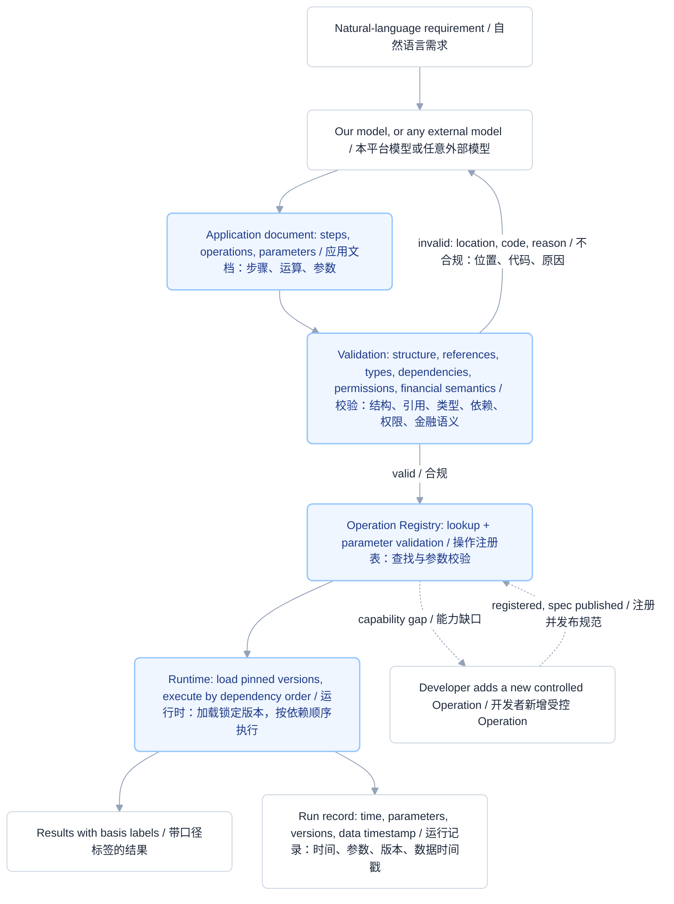

# Operation Registry | 操作注册表

**The most consequential technical design in the platform.**
**整个平台最关键的技术设计。**

- Team / 团队：Team HKU
- Related sections / 相关章节：Platform.md §3.2 Multi-step computation and extensible logic、§4.3 The financial operation library、§3.4 Generation, validation and correction
- Related commitments / 对应交付承诺：C02, C03, C07, C08, C11

---

## 1. The design decision | 设计决定

Every function is implemented and tested by a developer. The AI never rewrites them. It outputs a structured application document that states *what to call, with which parameters, in which order*. The Runtime reads that document, resolves each step against the registry, validates the parameters, loads the specified model version, and executes step by step.

每一个函数都由开发人员实现并测试。AI 从不重新编写它们。AI 输出的是一份结构化应用文档，声明*调用什么、用什么参数、按什么顺序*。Runtime 读取该文档，将每个步骤在注册表中解析，校验参数，加载指定版本的模型，再逐步执行。

**The division of labour is the whole point: the AI decides how capabilities are composed; the platform engineer decides how each capability is implemented internally.**

**分工本身就是重点：AI 决定功能如何被组合，平台工程师决定每个功能内部究竟如何实现。**

This is what makes the platform a shipping platform rather than another code generator. Generated code is unaudited, unbounded and undeployable; a composed set of registered operations is bounded, versioned, validated before it runs, and already installed on the machine that executes it.

这正是本平台成为"交付平台"而非又一个代码生成器的原因。生成的代码未经审计、边界不明、难以部署；而由已注册运算组合而成的应用，边界明确、有版本、运行前经过校验，且执行它的组件已经安装在机器上。

---

## 2. What an Operation is | 一个 Operation 是什么

An Operation is a unit of financial or statistical computation, written in real code by us, registered into the platform, and published to the AI as a parameter specification. It is not a prompt, not a template, and not something the model may reimplement.

Operation 是一个金融或统计计算单元，由我们以真实代码编写，注册进平台，并以参数规范的形式发布给 AI。它不是提示词，不是模板，也不是模型可以自行重新实现的东西。

Every Operation declares the same contract, which is also what the machine-readable specification publishes (§3.7, C11):

每个 Operation 都声明同一份契约，这份契约也正是机器可读规范所发布的内容（§3.7，C11）：

| Contract element / 契约要素 | What it carries / 它承载什么 |
| --- | --- |
| Parameter schema / 参数规范 | Names, types, ranges, defaults, and which are mandatory. Validated before execution, not discovered at runtime.<br>名称、类型、取值范围、默认值，以及哪些必填。在执行前校验，而不是在运行时才暴露。 |
| Required data basis / 所需数据口径 | Which catalogue domains and fields it reads, and on what basis — adjusted or raw prices, consolidated or parent-only, cumulative or single-quarter.<br>读取哪些目录领域与字段，以及依据何种口径——复权或未复权价格、合并或母公司报表、累计或单季数。 |
| Preconditions / 前提条件 | The data conditions that must hold: minimum observation count, series continuity, denominator availability, publication date preceding the run's data timestamp. Unmet preconditions fail validation with a named step and a reason.<br>必须成立的数据条件：最低观测数、序列连续性、分母可得性、披露日期早于本次运行的数据时间戳。前提不满足即校验失败，并指明具体步骤与原因。 |
| Emitted labels / 输出口径标签 | Unit, sample window, annualisation convention, adjustment basis, share base used, and the data timestamp read. A number without its basis is neither reproducible nor comparable, so no Operation produces one.<br>单位、样本区间、年化约定、复权基准、所用股本基数，以及读取的数据时间戳。没有口径的数字既不可复现也不可比对，因此任何 Operation 都不产出这样的数字。 |
| Failure modes / 失效情形 | What the Operation does *not* answer, and how it behaves on undefined input — negative earnings, zero interest expense, missing sessions. It refuses; it does not truncate, substitute or return a partial figure.<br>该 Operation 不回答什么，以及面对无定义输入时的行为——负盈利、利息费用为零、缺失交易日。它拒绝执行，不截断、不替代、不返回部分结果。 |
| Version / 版本 | Implementation version and, where a model is involved, the pinned model version. Recorded in the run record so a past result can be reproduced.<br>实现版本，以及涉及模型时锁定的模型版本。记入运行记录，使过往结果可复现。 |

**Example — one registered Operation as published to the AI:**

**示例——一个已注册 Operation 发布给 AI 时的形态：**

```json
{
  "operation": "sharpe_ratio",
  "version": "1.2.0",
  "domain": "returns_risk_drawdown",
  "parameters": {
    "returns_series": { "type": "series_ref", "required": true },
    "benchmark":      { "type": "index_ref",  "required": true },
    "risk_free_rate": { "type": "decimal",    "required": true,
                        "note": "explicit, with stated source and date; no internal default" },
    "window_days":    { "type": "integer",    "required": false, "default": 250,
                        "constraint": "<= catalogue coverage window" }
  },
  "required_basis": { "price_adjustment": ["forward", "backward"], "grain": "security/day" },
  "preconditions": [
    "observation_count >= minimum for the stated annualisation convention",
    "series continuous; suspension gaps reported, not treated as price moves"
  ],
  "emits": ["value", "unit", "sample_window", "annualisation_convention",
            "adjustment_basis", "risk_free_rate_source", "data_timestamp"],
  "failure_modes": ["insufficient_history", "undefined_benchmark", "unadjusted_series_bound"]
}
```

The AI's job ends at naming this and filling in the parameters. Everything inside it — the annualisation, the risk-free-rate handling, the precondition checks, the label emission — is ours, tested, and versioned.

AI 的工作到"指定这个运算并填入参数"为止。它内部的一切——年化处理、无风险利率处理、前提检查、标签输出——都属于我们，已测试，且有版本。

---

## 3. The execution path | 执行路径



Six things happen, in order, and each is a place where a generated program would normally fail silently:

依次发生六件事，每一件都是生成式程序通常会静默出错的地方：

1. **Composition, not authorship / 组合，而非编写.** The model emits a document that names Operations and sets parameters. It emits no executable code. The document is structured data, which is precisely why it can be checked before it runs (§3.4).
   模型产出一份指名运算、设定参数的文档，不产出可执行代码。文档是结构化数据，这正是它能在运行前被检查的原因（§3.4）。
2. **Registry lookup / 注册表查找.** The Runtime resolves every named Operation against the registry. A name that does not exist is a validation error, not a runtime exception discovered in front of the user.
   Runtime 将每个被指名的运算在注册表中解析。不存在的名称是校验错误，而不是当用户面才发现的运行时异常。
3. **Parameter validation / 参数校验.** Types, ranges, mandatory fields, and — the part that matters financially — the required data basis. An Operation requiring adjusted prices cannot be wired to a raw series; validation names the step and the mismatch (§4.2).
   校验类型、取值范围、必填项，以及金融上真正关键的部分——所需数据口径。要求复权价格的运算无法接到未复权序列上；校验会指出具体步骤与不匹配之处（§4.2）。
4. **Version loading / 版本加载.** The pinned implementation version and, where a step calls a configured model, the pinned model version. This is what makes a run record reproducible rather than merely historical.
   加载锁定的实现版本，以及当某步骤调用已配置模型时锁定的模型版本。这使运行记录可复现，而不只是留档。
5. **Ordered execution / 有序执行.** Steps execute according to their dependencies and pass intermediate results onward; queries shape, join, filter and rank catalogue data; specification-compliant expressions cover what no named Operation addresses (§3.2).
   各步骤按依赖关系执行并向后传递中间结果；查询负责对目录数据进行整形、关联、过滤与排序；符合规范的表达式覆盖没有任何具名运算涉及的情形（§3.2）。
6. **Labelled output / 带标签输出.** Every value leaves the Runtime carrying its basis. The inspection panel renders it, so the user can see not only the number but the unit, the window, the adjustment basis and the denominator that produced it (§3.5).
   每个数值离开运行时时都携带其口径。检查面板负责渲染，因此用户看到的不只是数字，还有产生它的单位、区间、复权基准与分母（§3.5）。

---

## 4. The extension path | 扩展路径

When a requirement cannot be met by any existing Operation, the answer is not to let the model improvise. A developer implements a new **controlled** Operation, declares the same contract every built-in declares, registers it into the platform, and publishes its parameter specification to the AI. From that moment the model can compose it exactly like any other, and it is subject to exactly the same validation.

当现有运算无法满足某个需求时，答案不是让模型自行发挥。由开发者实现一个新的**受控** Operation，声明与每个内置运算相同的契约，注册进平台，并把它的参数规范发布给 AI。从那一刻起，模型可以像使用其他运算一样组合它，而它也接受完全相同的校验。

Two consequences follow, and they are the reason this design scales without losing trustworthiness:

由此产生两个结果，也正是这一设计能够在不失去可信度的前提下扩展的原因：

**The capability surface expands while remaining bounded.** Blocks can be added indefinitely, so the platform is never a dead end — but at no point can an application do something no registered Operation does. What an application can do stays inspectable, which is the property an organisation needs when a tool touches client data (§1, §3.8).

**能力面持续扩张，同时保持有界。** 构建块可以无限增加，因此平台永远不会成为死胡同——但在任何时刻，应用都做不到任何已注册运算做不到的事。应用能做什么始终可检查，而这正是机构在工具触及客户数据时所需要的属性（§1、§3.8）。

**The AI's competence is not the ceiling.** Because new capability enters through the registry rather than through the model, the platform does not bet on AI improving — and equally, it is not embarrassed when AI does improve. A better model composes the same registered Operations more accurately; a worse model produces documents that validation rejects with a location, a code and a reason.

**AI 的能力不是上限。** 由于新能力经由注册表进入，而非经由模型，平台既不押注 AI 会进步，同样也不会在 AI 真的进步时陷入被动。更强的模型只是更准确地组合同一批已注册运算；更弱的模型产出的文档会被校验以位置、代码与原因拒绝。

This is the same mechanism §3.2 describes as "a way through for work that no combination of the above can express" — logic in which each step depends on the outcome of the one before it, or bookkeeping carried forward between runs. It enters as a registered Operation under the same restrictions as everything else, not as an escape hatch.

这与 §3.2 所述"上述组合无法表达之工作的通路"是同一机制——每一步依赖前一步结果的逻辑，或需要跨次运行结转的状态。它以受相同限制的注册运算形式进入，而不是一个逃生舱口。

---

## 5. How the algorithm work is engineered | 算法部分的工程性如何结合

The algorithm layer is where the financial and statistical substance lives. Engineering it is not about wrapping it in a service; it is about making every piece of it **declarative, testable, versioned and refusal-capable**. The table maps each engineering property to the mechanism that delivers it and to the failure it prevents.

算法层是金融与统计实质所在之处。把它工程化，不是给它套一层服务，而是让其中每一部分都**可声明、可测试、有版本、能拒绝执行**。下表把每项工程属性映射到承载它的机制，以及它所防止的错误。

| Engineering property / 工程属性 | Mechanism / 机制 | What it prevents / 它防止了什么 |
| --- | --- | --- |
| **Numerical correctness is asserted, not assumed**<br>数值正确性是被断言的，而非假定的 | Preconditions declared on every Operation and checked at validation (§4.3). Minimum observation count, series continuity, denominator availability.<br>每个 Operation 声明前提并在校验阶段检查（§4.3）：最低观测数、序列连续性、分母可得性。 | A 250-day rolling window on two years of history; a percentile rank over a four-member sector; a volatility cone whose history is shorter than its shortest lookback. Each is rejected with the count available and the count required.<br>两年历史上使用 250 日滚动窗口；四成员行业上的百分位排名；历史短于最短回看窗口的波动率锥。各自被拒绝，并给出可用与所需观测数。 |
| **Financial semantics live in one place**<br>金融语义集中于一处 | Required data basis declared per Operation; point-in-time and adjustment rules applied by the platform, not by the application author (§4.2, §4.4).<br>每个 Operation 声明所需数据口径；时点与复权规则由平台施加，而非由应用作者负责（§4.2、§4.4）。 | Look-ahead bias from reading a report before its publication date; a dividend rendered as an eight-percent crash; cumulative figures compared against single-quarter ones. |
| **Undefined values refuse rather than degrade**<br>无定义值拒绝执行，而非降级返回 | Declared failure modes; the Operation returns an error, not a plausible number (§4.3, §4.5).<br>声明失效情形；运算返回错误，而非一个看似合理的数字（§4.3、§4.5）。 | Negative P/E sorted as though it were low; interest coverage computed on zero interest expense; a blank pledge field read as zero leverage. |
| **Every result is reproducible**<br>每个结果可复现 | Operation version, pinned model version and data timestamp all recorded per run (§3.6).<br>每次运行记录运算版本、锁定的模型版本与数据时间戳（§3.6）。 | A past result that cannot be regenerated because the implementation, the model or the data state moved underneath it. |
| **Every result is comparable**<br>每个结果可比对 | Basis labels emitted alongside the value — unit, window, annualisation convention, adjustment basis, share base (§4.3).<br>随数值输出口径标签——单位、区间、年化约定、复权基准、股本基数（§4.3）。 | Two numbers rendered side by side that were computed on different bases and therefore mean different things. |
| **The algorithm is unit-testable in isolation**<br>算法可独立进行单元测试 | An Operation is a function with a declared contract, so it is tested against fixtures before it is ever composed. Validation errors are machine-readable — location, code, reason — so tests assert on structure, not on strings.<br>Operation 是带声明契约的函数，因此在被组合之前即可针对固定样本测试。校验错误机器可读——位置、代码、原因——因此测试断言的是结构而非字符串。 | A regression introduced by editing one calculation and discovered three applications later, in front of a user. |
| **New mathematics cannot break old applications**<br>新增数学不会破坏既有应用 | Versioned registration; a new Operation joins the library only after declaring the same contract, then faces the same validation (§4.3 Extending the library).<br>带版本注册；新运算只有在声明相同契约后才能加入运算库，此后接受相同校验（§4.3 运算库扩展）。 | Capability growth purchased at the cost of the bounded, inspectable property that made the platform trustworthy. |
| **Model access is a controlled step**<br>模型访问是受控步骤 | A dedicated step calls a configured AI model through a single platform interface, at a pinned version, from inside the running application (§3.2).<br>专门的步骤通过平台统一接口，在应用运行过程中以锁定版本调用已配置的 AI 模型（§3.2）。 | An application quietly depending on whatever model happened to be configured, or on prompt text nobody versioned. |
| **Claim boundaries are enforced by code**<br>结论边界由代码强制执行 | Claim-boundary validation rejects an interface element or AI step that presents an indicator as a forecast, or an anomaly score as a probability of misconduct (§4.5).<br>结论边界校验拒绝把指标呈现为预测、或把异常评分呈现为舞弊概率的界面元素与 AI 步骤（§4.5）。 | The platform crossing, by accident, the boundary it is not willing to have crossed. |
| **No algorithm reaches outside its sandbox**<br>任何算法都不越出其沙箱 | Applications reach data and models only through authorised platform interfaces; no host file system, no arbitrary network (§3.8). Credentials are held by the platform and never appear in an application or an exported file (§3.1).<br>应用只能通过平台授权接口访问数据与模型；不读宿主文件系统，不发任意网络请求（§3.8）。凭据由平台持有，绝不出现在应用或导出文件中（§3.1）。 | An externally generated application becoming a security exposure rather than an untrusted document that validation holds to the same standard. |

**The one-sentence version, for the presentation:** *the AI chooses which registered Operations to compose and with what parameters; every Operation's internal mathematics, its preconditions, its basis labels and its failure modes are implemented, tested and versioned by us — so the model can be wrong about A-share mechanics and still be stopped before it produces a wrong number.*

**用于答辩的一句话版本：** *AI 选择组合哪些已注册运算、用什么参数；每个运算内部的数学、其前提条件、口径标签与失效情形，都由我们实现、测试并纳入版本——因此模型即使对 A 股机制理解有误，也能在产出错误数字之前被拦下。*

---

## 6. Correspondence with Platform.md §3.2 | 与 Platform.md 3.2 节的对应

§3.2 commits to four things. The Operation Registry is the single mechanism that delivers all four, which is why it is the load-bearing design rather than one component among several.

§3.2 承诺了四件事。操作注册表是同时交付这四件事的单一机制，这也是它属于承重设计、而非若干组件之一的原因。

| §3.2 commitment / §3.2 的承诺 | Registry mechanism / 注册表机制 |
| --- | --- |
| **A library of named operations covering financial and statistical work** — ratios and growth rates, rolling windows, dispersion and correlation, rankings and percentiles, market-defined quantitative factors. Because they are written in real code, mathematical complexity sets no limit on what an application can compute.<br>**覆盖金融与统计工作的命名运算库**——比率与增长率、滚动窗口、离散度与相关性、排名与分位数，以及市场数据本身定义的量化因子。由于以真实代码实现，数学复杂度不构成应用计算能力的上限。 | Groups A–F of §4.3 are registered Operations. Each is real code with a declared contract, so an application names it and sets parameters rather than asking a model to derive it.<br>§4.3 的 A–F 组即已注册 Operation。每一个都是带声明契约的真实代码，因此应用只需指名并设参，而非要求模型自行推导。 |
| **Specification-compliant expressions and queries** shape, join, filter and rank catalogue data, covering what no named operation addresses.<br>**符合规范的表达式与查询**对目录数据进行整形、关联、过滤与排序，覆盖没有任何具名运算涉及的情形。 | Expressions and queries are themselves registered step types with their own parameter schemas, resolved and validated by the same registry path.<br>表达式与查询本身即为已注册的步骤类型，拥有各自的参数规范，经由同一条注册表路径解析与校验。 |
| **Multi-step computation** executing according to dependencies and passing intermediate results onward; a dedicated step calling a configured AI model during execution.<br>**多步骤计算**按依赖关系执行并向后传递中间结果；专门的步骤在运行过程中调用已配置的 AI 模型。 | The Runtime performs dependency-ordered execution over resolved registry entries, and the AI step is one registered step type with a pinned model version — not a special case outside the registry.<br>Runtime 在已解析的注册表条目上执行依赖排序，AI 步骤是一种带锁定模型版本的已注册步骤类型——不是注册表之外的特例。 |
| **A way through for special logic** — each step depending on the previous outcome, or state carried between runs — under the same restrictions as everything else.<br>**特殊逻辑的通路**——每一步依赖前一步结果，或跨次运行结转状态——与其他部分在相同限制下运行。 | New controlled Operations, registered after declaring the standard contract, published to the AI as parameter specifications (§4 of this document).<br>新增受控 Operation，在声明标准契约后注册，并以参数规范形式发布给 AI（见本文档第 4 节）。 |

---

## 7. Answering the two questions the judges will ask | 回答评委必问的两个问题

**"Why should I not just use Claude Code?"**
Because Claude Code produces code, and code is not a shipped application. Somebody still has to host it, schedule it, monitor it and repair it when the data changes, and inside an organisation nobody is assigned to that. We do not compete with the model — a user may generate our application document *with* Claude Code or ChatGPT against our published specification, and it will be validated, imported and run like any other (§3.7, C03). What we supply is the part that is still missing after the model has done a good job: a registry of tested capability, a runtime that executes it, validation that holds it to financial semantics, and a run record that makes it auditable.

**"为什么不直接用 Claude Code？"**
因为 Claude Code 产出的是代码，而代码不是已交付的应用。仍然需要有人托管、调度、监控它，并在数据变化时修复它——而在机构内部，没有人被指派承担这件事。我们不与模型竞争：用户完全可以用 Claude Code 或 ChatGPT，依据我们发布的规范生成应用文档，它会与其他应用一样被校验、导入并运行（§3.7，C03）。我们提供的是模型做好本职之后仍然缺失的那一部分：一套经测试的能力注册表、执行它的运行时、把它约束在金融语义上的校验，以及使其可审计的运行记录。

**"How do you evaluate that your solution is good?"**
Evaluation is built into the design rather than bolted on afterwards. Four measurable checks, each demonstrable with a real application:

**"你们如何评估方案是好的？"**
评估内建于设计，而非事后附加。四项可度量检查，每一项都能用一个真实应用演示：

1. **Rejection precision / 拒绝的准确性.** For each of the eight financial-semantic check classes (§4.5), an application that should fail does fail, and the error names the step, the precondition and the counts involved. The metric is: does it catch the error, and does the report tell the author how to fix it.
   对八类金融语义检查（§4.5）中的每一类，一个应当失败的应用确实失败，且错误指明步骤、前提与相关数量。度量标准是：是否拦住了错误，以及报告是否告知作者如何修正。
2. **No silent wrong numbers / 没有静默的错误数字.** An Operation whose precondition cannot be met never returns a partial or substituted figure. Measured by attempting each documented failure mode and confirming refusal.
   前提无法满足的运算绝不返回部分或替代结果。通过逐一触发已记录的失效情形并确认其拒绝执行来度量。
3. **Reproducibility / 可复现性.** The same application, re-run against the same data timestamp, produces the same value *and the same basis labels*. This is the direct evidence that version pinning works.
   同一应用，依据同一数据时间戳重新运行，产出相同数值*以及相同口径标签*。这是版本锁定生效的直接证据。
4. **Round-trip through an external model / 经由外部模型的往返.** An application document produced by a model that is not ours passes validation and runs unmodified — the strongest available evidence that the registry's published specification is complete rather than aspirational (C03).
   由非本平台模型产出的应用文档通过校验并未经修改即可运行——这是注册表所发布规范完备而非仅停留在愿望层面的最有力证据（C03）。

A second, independent evaluation is worth running if time allows, and it is what commercial teams do: have two models generate an application for the same requirement and cross-check the results against each other rather than against a human, then have one summarise where they diverge. Divergence points are the places where the registry's specification is ambiguous, which makes this a specification test disguised as a model test.

若时间允许，值得再跑一项独立评估，这也正是商业团队的做法：让两个模型针对同一需求各生成一个应用，把结果相互交叉校验而非由人校验，再让其中一个总结分歧之处。分歧点正是注册表规范含糊的地方——因此这本质上是一次伪装成模型测试的规范测试。

---

## 8. Evidence at completion | 完成时的举证

| Registry element / 注册表要素 | Delivered under / 交付承诺 | Evidence / 举证方式 |
| --- | --- | --- |
| Groups A–F registered, with contracts and labels<br>A–F 组已注册，含契约与标签 | C07, C08, C11 | Each Operation listed in the machine-readable specification with inputs, required basis, preconditions, emitted labels and failure modes; a runnable example exercises at least four groups and its interface displays the labels.<br>每个运算在机器可读规范中列出输入、所需口径、前提、输出标签与失效情形；一个可运行示例调用至少四组运算，其界面展示所输出的标签。 |
| Validation and the correction cycle<br>校验与修正流程 | C02, C03 | Each check class demonstrated by an application that fails it, with location, code and reason; the correction-and-revalidation cycle resolves a generated case automatically; an externally generated application is imported and held to the same checks.<br>每类检查均由一个触发失败的应用演示，给出位置、代码与原因；修正与重新校验流程自动解决一个生成类案例；一个外部生成的应用被导入并接受相同检查。 |
| Extension path<br>扩展路径 | C07, C11 | The developer guide documents the contract a new Operation must declare, and a worked example adds one.<br>开发指南说明新运算必须声明的契约，并有一个示例完成新增。 |
| Reproducible runs<br>可复现的运行 | C09 | A run record shows time, parameters, status, results, failure reason, application version, Operation and model versions, and the data timestamp used.<br>运行记录显示时间、参数、状态、结果、失败原因、应用版本、运算与模型版本，以及所用数据时间戳。 |
| Published specification<br>已发布规范 | C11 | The specification is generated from the platform's own code, so it cannot go out of date; the validity check is callable standalone.<br>规范由平台代码自动生成，因此不会过期；校验功能可独立调用。 |
